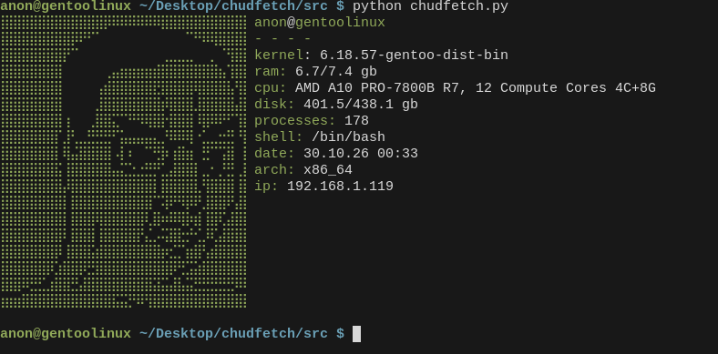

# chudfetch
chudfetch is a CLI util like fastfetch but cooler


## installation

### 1. clone the repository
```bash
git clone https://github.com/Efesint/chudfetch.git
cd chudfetch
```
### 2. compile
```bash
g++ chudfetch.cpp -o chudfetch
```
### 3. install to the system
```bash
mkdir -p ~/bin
cp chudfetch ~/bin/
echo 'export PATH="$HOME/bin:$PATH"' >> ~/.bashrc
source ~/.bashrc
chmod +x ~/bin/chudfetch
```

## DISCLAIMER
<br>This software is provided "AS IS", without warranty of any kind, express or implied, including but not limited to the warranties of merchantability, fitness for a particular purpose, and non-infringement.
<br>The author IS NOT RESPONSIBLE for any damage, data loss, server meltdowns, job termination, relationship breakdowns, or global thermonuclear war arising from the use or inability to use this software.
<br>Important: This project was created purely for comedic/satirical purposes. It is a joke. The author does not maintain, support, or guarantee that this code will work in any environment. Use at your own risk. Seriously.

# LICENSE 
This product is released under the GNU General Public License v3.0
<br> see in LICENSE...
