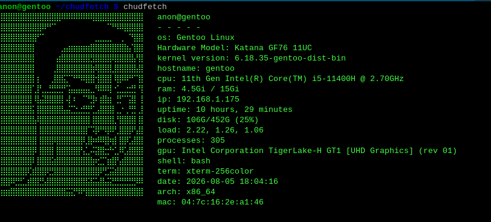

# chudfetch
chudfetch is a CLI util like fastfetch but cooler


## installation

### 1. clone the repository
```bash
git clone https://github.com/Efesint/chudfetch.git
cd chudfetch
```
### 2. compile
```bash
g++ chudfetch.cpp -o chudfetch
```
### 3. install to the system
```bash
mkdir -p ~/bin
cp chudfetch ~/bin/
echo 'export PATH="$HOME/bin:$PATH"' >> ~/.bashrc
source ~/.bashrc
chmod +x ~/bin/chudfetch
```

## description
...
